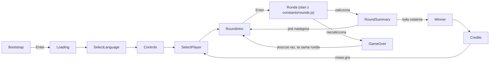

# Jak rozwijać 7balls

Informacje techniczne: uruchamianie, budowanie, struktura kodu i wdrożenie. Opis samej gry jest w [README.md](./README.md).

## Wymagania

- Node.js w wersji z pliku [.nvmrc](./.nvmrc) (`nvm use`)
- npm

## Uruchomienie lokalnie

```bash
npm install
npm run dev
```

`npm run dev` składa grę w katalogu `dist/`, serwuje ją na pierwszym wolnym porcie od 3000 (adres wypisuje w terminalu) i pilnuje zmian: po edycji kodu w `src/app/` przebudowuje paczkę, a po edycji plików w `src/public/` kopiuje je ponownie. Stronę w przeglądarce trzeba odświeżyć ręcznie. Port można wymusić zmienną `PORT`.

Wersję produkcyjną buduje `npm run build`. Wynik to kompletna gra w `dist/` (paczka z kodem, Phaser i kopia plików statycznych), którą można podać dowolnym serwerem plików statycznych, np. `npx serve dist`. Otwarcie `index.html` prosto z dysku (`file://`) nie zadziała, bo gra pobiera mapy i tłumaczenia przez XHR.

## Skrypty npm

| Skrypt              | Co robi                                                                                          |
| ------------------- | ------------------------------------------------------------------------------------------------ |
| `npm run dev`       | Tryb deweloperski: serwer lokalny, przebudowa paczki i kopiowanie plików statycznych po zmianach |
| `npm run build`     | Czyści `dist/`, buduje `dist/bundle.js`, kopiuje `src/public/` i Phasera do `dist/`              |
| `npm run watch`     | Sama przebudowa paczki po zmianach w `src/app/`, bez serwera                                     |
| `npm run deploy`    | Wypycha zawartość `dist/` na gałąź `gh-pages`                                                    |
| `npm run clear`     | Usuwa `dist/`                                                                                    |
| `npm run clear:all` | Usuwa dodatkowo `node_modules/`                                                                  |
| `npm run count`     | Liczy linie kodu w plikach `.js`                                                                 |

Skrypty `build`, `watch` i `dev` ustawiają `NODE_OPTIONS=--openssl-legacy-provider`. Webpack 4 liczy skróty algorytmem MD4, którego nowsze wersje Node.js nie udostępniają bez tej flagi.

## Technologie

- [Phaser 2](https://phaser.io/) (silnik gry, ładowany jako osobny plik `phaser.js`)
- Babel 7 i Webpack 4
- [super-event-emitter](https://github.com/piecioshka/super-event-emitter) (zdarzenia między stanami gry)
- Aseprite (grafika, pliki źródłowe `.aseprite` leżą obok wyeksportowanych `.png`)

Projekt powstał na bazie [boilerplate-babel-webpack](https://github.com/piecioshka/boilerplate-babel-webpack).

## Struktura katalogów

```text
scripts/                 skrypty pomocnicze builda
src/
├── app/                 kod gry
│   ├── main.js          punkt wejścia
│   ├── game.js          obiekt gry
│   ├── state-manager.js rejestracja stanów i przejścia między nimi
│   ├── states/          ekrany gry (stany Phasera)
│   ├── models/          gracz, przeciwnik i gatunki postaci
│   ├── helpers/         komunikaty, przeciwnik, pełny ekran, ściąga i restart (overlay), muzyka, kod Konami
│   └── constants/       ustawienia: rundy, utwory, rozmiar gry, prędkości, limity czasu, siła ciosów
└── public/              pliki statyczne kopiowane do dist/
    ├── index.html
    ├── og-image.png     obrazek Open Graph (1200x630)
    ├── favicon.svg      ikona strony (logo 7B)
    └── assets/          grafika, czcionka, mapy, pozycje kul, tłumaczenia
dist/                    kompletna gra po buildzie (poza repozytorium)
```

## Przebieg gry

Przejścia między ekranami są w jednym miejscu: `src/app/state-manager.js`. Stany komunikują się zdarzeniami emitowanymi na obiekcie gry.



Kolejność rund i ich muzykę ustala `src/app/constants/rounds.js`: `CollectDragonBalls`, `Fight`, `AvoidMonsters`, `Fight`, `DefendFriend`, `Fight`, `WhisTraining`, `Fight` i na końcu `Fight` jako Turniej Mocy. Nazwy, cele i sterowanie rund są w plikach tłumaczeń pod kluczem `ROUNDS`, w tej samej kolejności. Po każdej zaliczonej rundzie jest `RoundSummary`. Kolejność rywali (Freeza, Cell, Bubu, Beerus) ustala `select-player-state.js`, a skład turnieju `state-manager.js`.

## Postacie

Każda postać to klasa w `src/app/models/species/`, a lista wszystkich jest w `src/app/models/roster.js`. Klasa ustala imię, moc bazową (`power`), kolor fali energii (`wave`) i, u rywali, tło walki (`background`). Wzrost postaci wynika z jej proporcji w generatorze grafiki, a nie ze skalowania, więc piksele są wszędzie tej samej wielkości. Identyfikator postaci, używany w nazwach plików grafiki, powstaje z imienia (`Mr. Satan` to `mr-satan`).

## Moc i przemiany

Moc bazowa każdej postaci jest w jej klasie (`settings.power`), a reguły w `src/app/constants/power.js`: ile doświadczenia podwaja moc, jak różnica mocy zmienia siłę ciosu i ile mnożą, zabierają życia i wzmacniają ciosy przemiany Saiyan (`SAIYAN_FORMS`, z listą postaci, które mogą ich użyć) i Kaioken. Liczbę mocy liczy `Character#getPower()`, a siłę ciosu `getBlowStrength()` w `fight-state.js`.

## Czcionka

Wszystkie napisy w grze są pisane czcionką pikselową Press Start 2P (`src/public/assets/fonts/`, licencja SIL Open Font License w `PressStart2P-OFL.txt`), także tytuły, tylko w większych rozmiarach. Czcionka ma polskie znaki. Wygląda najlepiej w rozmiarach będących wielokrotnością 8 px.

## Muzyka

Muzyka i dźwięki są generowane w przeglądarce przez Web Audio (`src/app/helpers/music.js`), bez plików dźwiękowych. Utwory są zapisane nutami w `src/app/constants/tracks.js`: jeden dla menu i po jednym dla każdej rundy. Dźwięki (menu, ciosy, fala energii, wybuch) są w tablicy `SOUNDS` w tym samym pliku. Głośność ma trzy tryby i jest zapamiętywana w `localStorage`. W konsoli można przełączyć utwór ręcznie, np. `game.music.play('duel')`.

## Diagnostyka

Gra nie pisze nic do konsoli. Dopisanie `?debug` do adresu strony włącza logowanie zmian stanów i zdarzeń gry.

## Dane gry

- Mapy labiryntów: `src/public/assets/data/maps/collecting-*.json` (format Tiled)
- Pozycje smoczych kul: `src/public/assets/data/balls-positions/positions-*.json`
- Tłumaczenia: `src/public/assets/locale/pl_PL.json` i `en_EN.json`
- Limit czasu na zebranie kul: `MAPS_TIME_LIMIT` w `src/app/constants/collect.js`
- Ustawienia walki, lotu, obrony przyjaciela i treningu: `src/app/constants/fight.js`, `flight.js`, `defense.js` i `training.js`

## Wdrożenie

Gra jest hostowana na GitHub Pages z gałęzi `gh-pages`:

```bash
npm run build
npm run deploy
```

## Grafika postaci i scenerii

**Zasada: jeden rozmiar piksela.** Każdy obrazek w grze ma piksele 5x5 punktów ekranu, jak postacie narysowane ręcznie w wersji 1.3.4. Grafiki są zapisywane już w docelowym rozmiarze (rysowane na swojej siatce i powiększone 5 razy), a w kodzie nie wolno ich skalować (`scale.setTo` tylko z `1` albo `-1` do odbicia). Wyjątkiem jest tekst: ma zawsze 16 px (czcionka Press Start 2P ma piksel 8 px, więc to piksel 2x2), bo przy pikselu 5x5 w linii zmieściłoby się tylko ok. 20 znaków. Nową grafikę dodawaj przez generatory poniżej, nie z zewnętrznego programu w innej gęstości.

Wszystkie postacie rysuje skrypt. Ciało powstaje ze szkieletu: każda postać ma własne proporcje (długość nóg i tułowia, tusza), strój i szczegóły ciała (peleryna, ogon Freezy, skrzydła Cella). Głowy są narysowane ręcznie, piksel po pikselu, w `scripts/character-heads.js`: twarz z boku i z przodu oraz warstwy na niej (fryzury, także przemian Saiyan, turban Piccola, czułek Bubu, kopuła Freezy, uszy Beerusa, trzecie oko Tiena). Szablon to wiersze liter, a legenda liter jest na początku pliku.

Generator stosuje zasady pixel artu:

- cienie i światła przesuwają barwę (cień w stronę chłodnego fioletu, światło w stronę ciepłej żółci), zamiast mieszać kolor z czernią albo bielą;
- obrys postaci i linie między częściami są czarne, jak w wersji 1.3.4;
- wąskie części (do 3 pikseli) są cieniowane całym pasem, a samotne piksele innego koloru niż wszyscy sąsiedzi znikają przed narysowaniem głowy;
- brwi i usta mają własny, bardzo ciemny tusz.

```bash
node scripts/draw-characters.js
```

Skrypt wymaga ImageMagicka (`magick`) i zapisuje dla każdej postaci:

- arkusz walki `fight/<id>/<id>-spritesheet.png`: 3 kolumny i 10 rzędów klatek 30x40 pikseli powiększonych 5 razy (jeden piksel na jednostkę siatki, jak w wersji 1.3.4); rzędy 0-4 patrzą w prawo, rzędy 5-9 to te same klatki patrzące w lewo
- arkusz aury `fight/<id>/<id>-aura-spritesheet.png`: białe sylwetki tych samych klatek, barwione w grze
- kartę `posters/<id>/<id>-card.png` (80x120) z głową i ramionami oraz awatar `posters/<id>/<id>-avatar.png` (70x70) do paska walki, dla Saiyan także awatar każdej przemiany
- głowę do labiryntu `fight/<id>/<id>-mini-spritesheet.png` (klatki 60x60: głowa z profilu zmniejszona o połowę; stanie i 4 kroki chodu z podskokiem, rząd 0 w prawo, rząd 1 w lewo)
- mały arkusz lotu `fight/<id>/<id>-flight-spritesheet.png` (klatki 120x120: krótsze ciało z głową zmniejszoną o połowę; na chmurce, z falą i dwie klatki lotu w poziomie; rząd 0 w prawo, rząd 1 w lewo)
- drugi, szerszy arkusz aury `fight/<id>/<id>-big-aura-spritesheet.png` dla Kaiokenu
- dla Saiyan arkusz każdej ich przemiany `fight/<id>/<id>-<forma>-spritesheet.png` (`ssj`, `ssj2`, `ssj3`, `god`, `blue`)

Klatki w bloku: 0-2 stanie, 3-4 cios ręką, 5 skok, 6-7 kopnięcie, 8 unik, 9-11 przodem (wygrana, karta), 12-14 porażka. Numery są też w `src/app/helpers/sprites.js`.

Krajobrazy (Ziemia, Namek, pustkowie, miasto, planeta Beerusa, ring turnieju), tła ekranów końcowych, kafelki map, smocze kule (małe na mapie i z gwiazdkami 1-7 do rogu ekranu), chmury, Kinto, fale energii, głaz i wybuch, paski życia i logo rysuje drugi skrypt, a labirynty trzeci:

```bash
node scripts/draw-scenery.js
node scripts/draw-mazes.js
```

Obrazek Open Graph (`src/public/og-image.png`, 1200x630) składa z grafik gry czwarty skrypt; uruchom go po generatorach postaci, żeby pokazywał aktualne postacie:

```bash
node scripts/draw-og-image.js
```

Labirynty 1-3 są zrobione ręcznie w Tiled; skrypt dokłada 4-10 i sprawdza, że da się dojść do każdej kuli w rozsądnym czasie.

## Zrzuty ekranu

Zrzuty do README leżą w `docs/screenshots/<widok>.png` (800x400, czyli rozmiar pola gry).

## Pomysły na rozwój

Lista zadań jest w [issues na GitHubie](https://github.com/piecioshka/7balls/issues). Pomysły na fabułę są w [docs/story.md](./docs/story.md).

## Inspiracje graficzne

- <https://www.wykop.pl/link/2734787/goku-vs-street-fighter-2/>
- <https://i.pinimg.com/236x/bc/3b/a9/bc3ba9721a4698e58055a748efb2fb21.jpg>
- <https://i.pinimg.com/236x/2f/d2/b7/2fd2b78b17f8eeebf7ad7368f2e8c8d3.jpg>
- <https://i.pinimg.com/236x/55/fc/a8/55fca80f935845e7a4cdcb74d436ec85.jpg>
