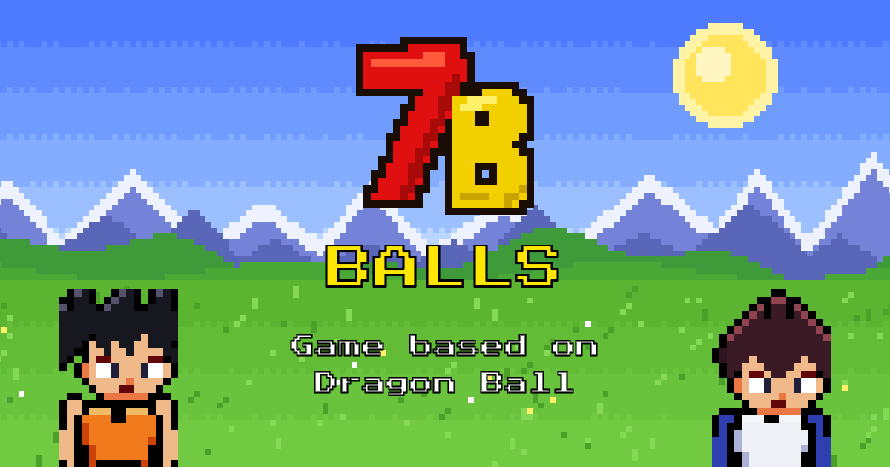
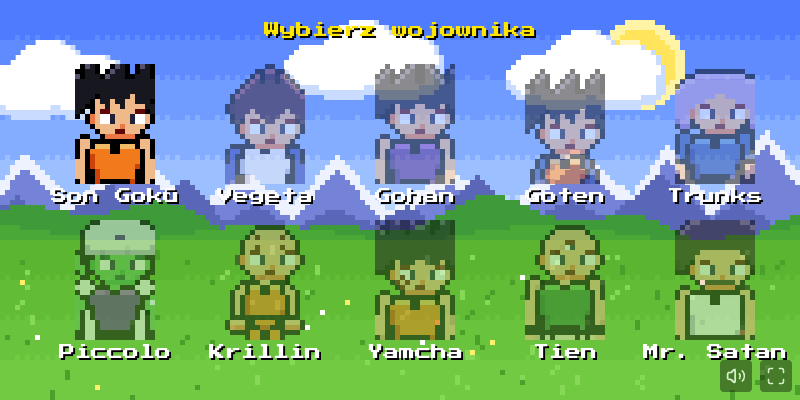
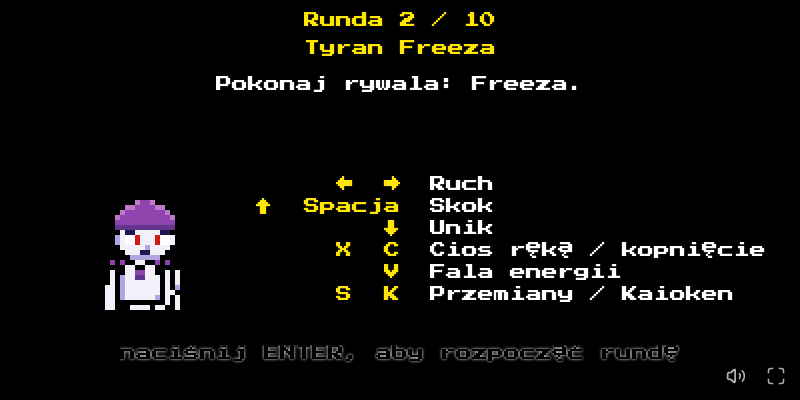
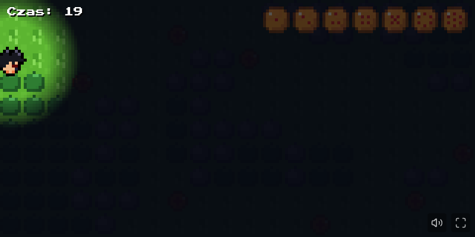
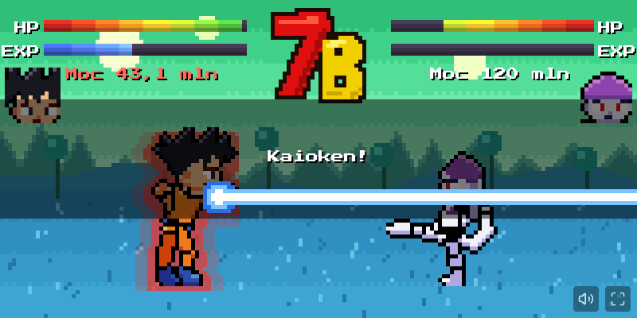
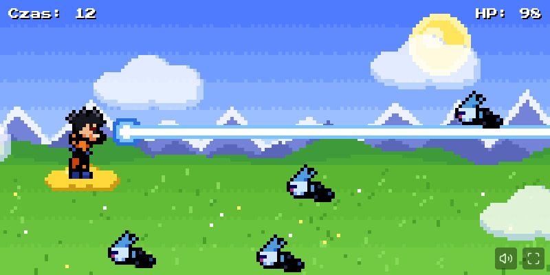
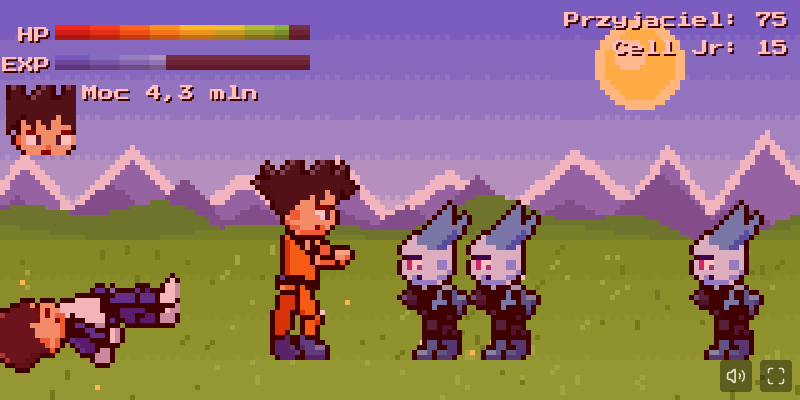
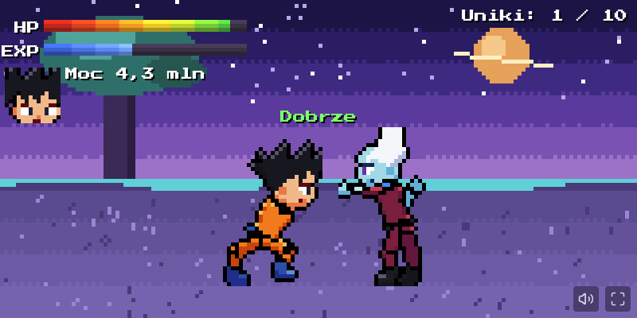
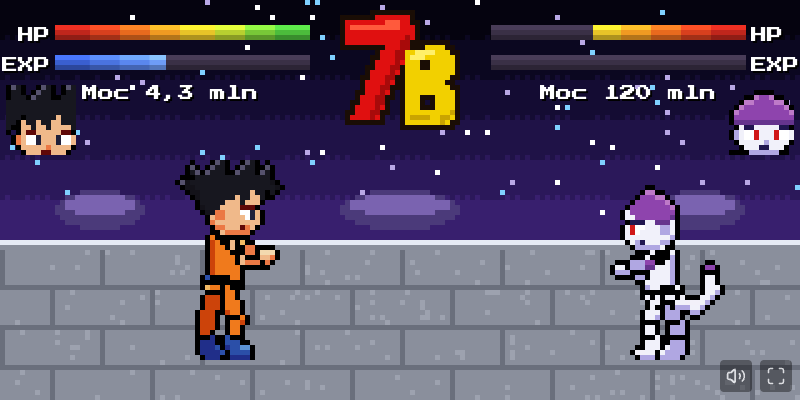

# 7balls

🎮 Gra webowa w pixel arcie oparta na anime "Dragon Ball". Zbierz siedem smoczych kul, zanim skończy się czas, albo stań do walki z kolejnymi potworami.

<!-- prettier-ignore-start -->

<!-- prettier-ignore-end -->

**Zagraj w przeglądarce:** <https://piecioshka.github.io/7balls/>

## Funkcje ✨

- 🥋 Dziesięciu wojowników do wyboru, od Son Goku po Mr. Satana
- 🏁 Dziesięć nazwanych rund z wprowadzeniem i podsumowaniem każdej
- 🐉 Zbieranie siedmiu smoczych kul na czas, w ciemności _(dziesięć różnych labiryntów)_
- 🥊 Walki z Freezą, cyborgami (C-17, C-18, C-16), Cellem, Bubu i Beerusem, każdy w swoim miejscu
- ⚡ Fala energii, unik i skok, także u przeciwników
- ☁️ Lot na żółtej chmurze z niszczeniem Cell Jr. falą energii
- 🛡️ Obrona rannego przyjaciela i trening z Whisem
- 🏆 Turniej Mocy na koniec: wszyscy rywale z gry po kolei na ringu
- 📈 Liczby mocy z fabuły (Son Goku 3 000 000, Freeza 120 000 000), które rosną z doświadczeniem
- 🔥 Przemiany w walce: Super Saiyan 1, 2 i 3, God i Blue dla Saiyan oraz Kaioken dla każdego
- 🪐 Ukryty kod Konami: wszystkie miejsca zamieniają się w Namek, a w walce Saiyanin staje się Super Saiyanem
- 🎵 Mroczna muzyka dla menu i każdej rundy, dźwięki ciosów i okrzyk Kamehameha
- 🌍 Dwie wersje językowe: polska i angielska
- 🎨 Pixel art w jednej gęstości (piksel 5x5, jak w pierwszych wersjach gry) w całej grze, z głowami postaci rysowanymi ręcznie piksel po pikselu; każda postać ma własną sylwetkę i patrzy w obie strony
- 🌐 Działa w przeglądarce, bez instalacji

## Jak grać 🕹️

Ekran startowy czeka na `Enter`. Potem wybierz język, przeczytaj ekran ze sterowaniem i wybierz wojownika. Potem czeka dziesięć rund. Przed każdą gra pokazuje jej numer, nazwę, cel i sterowanie, a po każdej podsumowanie.

1. **Smocze kule:** zbierz siedem smoczych kul w 20 sekund; widać tylko okolicę zawodnika, a znalezione kule zapalają się w rogu ekranu.
2. **Tyran Freeza:** pokonaj Freezę na Namek.
3. **Lot na chmurze:** przez 15 sekund omijaj Cell Jr. albo niszcz ich falą energii.
4. **Cyborgi:** pokonaj po kolei C-17, C-18 i C-16.
5. **Doskonały Cell:** pokonaj Cella na pustkowiu.
6. **Obrona przyjaciela:** odpędzaj Cell Jr. od rannego przyjaciela; bez przemiany każdy potrzebuje trzech kopnięć, w przemianie wystarczy jedno. Przebiegają przez ciebie, a niektórzy przeskakują górą.
7. **Majin Bubu:** pokonaj Bubu w mieście.
8. **Trening z Whisem:** rób unik przed górnym ciosem, a dolny przeskakuj, co najmniej 7 razy na 10.
9. **Niszczyciel Beerus:** pokonaj Beerusa na jego planecie.
10. **Turniej Mocy:** pokonaj po kolei wszystkich rywali z gry.

Nieudaną rundę można powtórzyć z pełnym życiem.

W walkach liczy się moc. Każda postać ma swoją liczbę mocy z fabuły, a doświadczenie za celne ciosy ją zwiększa. Cios zabiera tym więcej życia, im silniejszy jest atakujący: dwa razy więcej za każdą dziesięciokrotną przewagę (najwyżej trzy razy więcej albo trzy razy mniej). Rywale są w fabule dużo silniejsi, więc trzeba używać przemian:

- **Przemiany Saiyan** (`S`, kolejne poziomy): Super Saiyan (moc razy 20, -4 HP/s), Super Saiyan 2 (razy 40, -6 HP/s), Super Saiyan 3 (razy 160, -10 HP/s), God (razy 400, -5 HP/s) i Blue (razy 1000, -7 HP/s). Każdy Saiyanin dochodzi do innego poziomu: Super Saiyan 3 ma tylko Son Goku, God i Blue Son Goku i Vegeta.
- **Kaioken** (`K`, każdy): moc razy 10, czerwona aura, -2 HP/s

Każda przemiana wzmacnia też same ciosy. Przemiany można łączyć, a kończą się same, gdy życia zostaje 10.

| Klawisz           | Co robi                                   |
| ----------------- | ----------------------------------------- |
| `←` `→` `↑` `↓`   | wybór w menu, ruch                        |
| `Enter`           | zatwierdzenie                             |
| `↑` albo `Spacja` | skok                                      |
| `↓`               | unik                                      |
| `X`               | cios ręką                                 |
| `C`               | kopnięcie                                 |
| `V`               | fala energii                              |
| `S`               | kolejna przemiana Saiyan (w walce)        |
| `K`               | Kaioken (w walce)                         |
| `F`               | pełny ekran                               |
| `M`               | głośność muzyki: głośno, cicho, wyłączona |
| `R`               | restart gry, po potwierdzeniu             |
| `?`               | ściąga skrótów i pauza                    |

Pełny ekran i głośność muzyki zmieniają też przyciski w prawym dolnym rogu pola gry.

## Zrzuty ekranu 📸

| Wybór wojownika                                          | Wprowadzenie do rundy                                        | Smocze kule                                                 |
| -------------------------------------------------------- | ------------------------------------------------------------ | ----------------------------------------------------------- |
|  |  |  |

| Walka z falą energii                   | Lot na chmurze                                           | Obrona przyjaciela                                          |
| -------------------------------------- | -------------------------------------------------------- | ----------------------------------------------------------- |
|  |  |  |

| Trening z Whisem                                          | Turniej Mocy                                       |
| --------------------------------------------------------- | -------------------------------------------------- |
|  |  |

## Geneza projektu 🎬

Gra powstała w 10 dni jako materiał do [prezentacji na WarsawJS](https://www.youtube.com/watch?v=klDeljOKDjU) o bibliotece Phaser.

Przy okazji powstało 25 filmów pokazujących kolejne etapy pracy. Wszystkie są na [playliście na YouTube](https://www.youtube.com/playlist?list=PLDTdlgCXlVhjAlKJ1W2Y12Xejvt4Ih02p), w kolejności chronologicznej.

## Dokumentacja 📚

- [CONTRIBUTING.md](./CONTRIBUTING.md): uruchamianie lokalnie, budowanie, struktura kodu, wdrożenie
- [docs/](./docs/README.md): notatki z 10 dni pracy, fabuła, lista postaci i mapa świata
- [CHANGELOG.md](./CHANGELOG.md): historia zmian
- [Issues](https://github.com/piecioshka/7balls/issues): lista pomysłów na rozwój

## Licencja 📄

[The MIT License](https://piecioshka.mit-license.org) @ 2015

Projekt fanowski, niezwiązany z właścicielami marki "Dragon Ball".
